# 🤖 ROS2-Autonomous-Navigation-Masterclass

> A complete, production-grade ROS 2 Humble curriculum and 4-wheel autonomous mobile robot (AMR) navigation capstone system, engineered side-by-side in both Python (`rclpy`) and Modern C++ (`rclcpp`). Features full Nav2 integration, custom C++ pluginlib Global Planners (A\* & Dijkstra), custom C++ Local Controllers (Pure Pursuit & PD Motion), multi-sensor EKF fusion (Wheel Odometry, 6-DOF IMU, 2D LiDAR), AMCL probabilistic localization, 3 Gazebo simulation environments (`nav_challenge`, `maze_world`, `obstacle_world`), active LiDAR safety zones, velocity multiplexing (`twist_mux`), programmatic autonomous missions, and physical Raspberry Pi hardware deployment.

<div align="center">
  
</div>

---

### ⚡ 60-Second Quickstart

```bash
# 1. Clone & enter workspace
git clone https://github.com/rahul-r-joshua/ROS2-Autonomous-Navigation-Masterclass.git ~/ros2_autonomous_navigation_ws && cd ~/ros2_autonomous_navigation_ws

# 2. Install dependencies & configure environment
bash Scripts/install_dependencies.sh && source Scripts/setup_environment.sh

# 3. Build workspace
bash Scripts/build_all.sh

# 4. Run automated 62-tier verification suite (100% pass guarantee)
python3 Scripts/verify_all_milestones.py

# 5. Launch Master All-in-One Autonomous Bringup (Simulation + Localization + Nav2 + RViz2)
source install/setup.bash && ros2 launch mobile_robot_bringup autonomous_navigation.launch.py world:=nav_challenge
```

---

## 📌 Table of Contents
- [Project Overview](#project-overview)
- [System Architecture](#system-architecture)
- [Autonomous Navigation & Safety Visualizer](#simulation-visualizer)
- [Repository & Workspace Structure](#workspace-structure)
- [Prerequisites](#prerequisites)
- [Installation & Workspace Setup](#installation-and-setup)
- [Automated Scripts & Utilities Reference](#automated-scripts-reference)
- [Detailed 11-Milestone Curriculum Walkthrough](#curriculum-walkthrough)
  - [🌐 Milestone 1: Simulation Environments & Multi-World Launch](#milestone-1)
  - [📡 Milestone 2: QoS Profiles & Sensor Diagnostics](#milestone-2)
  - [🗺️ Milestone 3: 2D LiDAR SLAM & Auto-Exploration](#milestone-3)
  - [💾 Milestone 4: Map Post-Processing & Costmap Serving](#milestone-4)
  - [⚡ Milestone 5: Custom Navigation Interfaces (Actions & Services)](#milestone-5)
  - [🎯 Milestone 6: AMCL Localization & Multi-Sensor EKF Fusion](#milestone-6)
  - [🧠 Milestone 7: Custom Global Planners (A\* & Dijkstra Plugins)](#milestone-7)
  - [🎮 Milestone 8: Custom Local Controllers (Pure Pursuit & PD Motion Plugins)](#milestone-8)
  - [🧭 Milestone 9: Nav2 Navigation Pipeline & Mission Dispatchers](#milestone-9)
  - [🚀 Milestone 10: Master All-in-One Autonomous Bringup](#milestone-10)
  - [🍓 Milestone 11: Real Robot Hardware Deployment on Raspberry Pi](#milestone-11)
- [Complete 11-Milestone Curriculum Matrix](#curriculum-matrix)
- [Multi-Simulator & Multi-World Matrix (18 Configurations)](#simulator-matrix)
- [Automated Master Test Suite (62/62 Checks Passed)](#automated-test-suite)
- [Architectural Deep Dives & Theory References](#architectural-deep-dives)
- [Frequently Asked Questions (FAQ)](#faq)
- [Author, Maintainer & Support](#author-and-support)

---

## <a id="project-overview" name="project-overview"></a>🦾 Project Overview

This repository provides an industrial-grade, end-to-end autonomous navigation curriculum and production AMR software stack built on **ROS 2 Humble**. It bridges the gap between mechanical robot physics and enterprise-level autonomous navigation. Developers are guided step-by-step from multi-world simulation physics, real-time sensor diagnostics, SLAM mapping, and probabilistic localization to writing custom C++ pluginlib engines for Nav2 (`nav2_core::GlobalPlanner` and `nav2_core::Controller`), orchestrating Behavior Trees with dynamic replanning, and executing master all-in-one bringups on both simulated and real Raspberry Pi robots.

### 🌟 Key Highlights:

* 🧠 **Custom C++ Nav2 Pluginlib Engines**: Native C++ implementations of **A\*** and **Dijkstra** global planners (`nav2_core::GlobalPlanner`) and **Pure Pursuit** and **PD Motion** local controllers (`nav2_core::Controller`), compiled as shared libraries and exported via plugin manifests.
* 🌐 **Multi-Simulator & Multi-World Support**: Native support across **Gazebo Classic 11**, **Ignition Gazebo (Fortress)**, and **Modern Gazebo (Gz Sim)** across 3 custom obstacle environments (`nav_challenge.world`, `maze_world.world`, `obstacle_world.world`).
* 🎯 **Decoupled & Fused Localization**: Dual-stack global localization featuring **AMCL** particle filter corrections alongside an extended **Robot Localization EKF** fusing wheel odometry, IMU angular velocity, and linear acceleration.
* 🛡️ **Active LiDAR Safety Zones & Twist Mux**: Multi-tier dynamic safety zones (Emergency Stop and Slowdown zones) with priority velocity arbitration managed by `twist_mux`.
* 🤖 **Autonomous Mission Dispatch Suite**: Comprehensive mission scripts via Nav2 Simple Commander API (`nav_to_pose.py`, `waypoint_follower.py`, `patrol_loop.py`) and universal interactive testing bridges (`plan_and_follow.py`).
* 🍓 **Real Hardware Edge Deployment**: Complete hardware bringup stack for **Raspberry Pi 4 / 5** with RPLiDAR A1/A2/A3, serial microcontroller bridge, and distributed DDS remote visualization.
* 🧪 **100% Automated 62-Tier Verification Suite**: Fully automated verification script ([`Scripts/verify_all_milestones.py`](Scripts/verify_all_milestones.py)) that validates all 11 packages, interface files, worlds, costmaps, plugins, launch files, and autonomous scripts.

---

## <a id="system-architecture" name="system-architecture"></a>🏗️ System Architecture

<p align="center">
  
</p>


---

## <a id="workspace-structure" name="workspace-structure"></a>📁 Repository & Workspace Structure

```text
ros2_autonomous_navigation_ws/
├── Scripts/                                     # Master Workspace Automation Suite
│   ├── install_dependencies.sh                  # Installs ROS 2 Humble, Nav2, Gazebo, and system pkgs
│   ├── setup_environment.sh                     # Sets ROS_DOMAIN_ID=0, ROS_LOCALHOST_ONLY=1, sources env
│   ├── build_all.sh                             # Topological colcon symlink build
│   ├── clean_build.sh                           # Clean purge (build/install/log) and complete rebuild
│   └── verify_all_milestones.py                 # Automated 62-tier verification suite (100% pass)
├── src/
│   ├── README.md                                # In-depth step-by-step 11-milestone implementation manual
│   ├── mobile_robot_description/                # Milestone 1: 3D URDF/Xacro, Sensors, Physics & Visualizers
│   ├── mobile_robot_controller/                 # Milestone 2: Kinematics, Velocity Controllers & Twist Mux
│   ├── mobile_robot_gazebo/                     # Milestone 1: Gazebo Classic, Ignition, and Modern Gz Worlds
│   ├── mobile_robot_mapping/                    # Milestones 3 & 4: SLAM Toolbox Configs, Saved Maps & YAMLs
│   ├── mobile_robot_msgs/                       # Milestone 5: Custom Action & Service Navigation Interfaces
│   ├── mobile_robot_localization/               # Milestone 6: AMCL, EKF Sensor Fusion & Odometry Motion Model
│   ├── mobile_robot_planning/                   # Milestone 7: Custom C++ A* & Dijkstra Nav2 Global Planners
│   ├── mobile_robot_motion/                     # Milestone 8: Custom C++ Pure Pursuit & PD Local Controllers
│   ├── mobile_robot_navigation/                 # Milestone 9: Nav2 Production Configs, BTs & Mission Scripts
│   ├── mobile_robot_bringup/                    # Milestones 10 & 11: Master Bringup & Real Robot Launchers
│   └── mobile_robot_firmware/                   # Milestone 11: Arduino/ESP32 Firmware & Serial Bridge
└── README.md                                    # Main Project Portal & Quick Reference Guide
```

---

## <a id="prerequisites" name="prerequisites"></a>📋 Prerequisites

* 🤖 **Foundation Workspace (Level 2 Prerequisite)**: [ROS2-Mobile-Robot-Masterclass](https://github.com/rahul-r-joshua/ROS2-Mobile-Robot-Masterclass)
* 🐧 **OS**: Ubuntu 22.04 LTS (Jammy Jellyfish)
* 🌐 **ROS 2**: Humble Hawksbill (`ros-humble-desktop`)
* 🐍 **Python**: 3.10+ (`transforms3d`, `pyserial`, `numpy`)
* ⚙️ **Compilers**: Modern C++17 (`gcc` / `g++` 11+) & `cmake` 3.8+
* 🧭 **Nav2 Packages**: `ros-humble-navigation2`, `ros-humble-nav2-bringup`, `ros-humble-nav2-costmap-2d`, `ros-humble-nav2-core`
* 🗺️ **SLAM & Localization**: `ros-humble-slam-toolbox`, `ros-humble-robot-localization`, `ros-humble-nav2-amcl`
* 🎮 **Simulators**: Gazebo Classic 11 (`ros-humble-gazebo-ros-pkgs`), Ignition Fortress (`ros-gz`), Modern Gz Sim

---

## <a id="installation-and-setup" name="installation-and-setup"></a>⚙️ Installation & Workspace Setup

### 1️⃣ Clone Workspace:
```bash
git clone https://github.com/rahul-r-joshua/ROS2-Autonomous-Navigation-Masterclass.git ~/ros2_autonomous_navigation_ws
cd ~/ros2_autonomous_navigation_ws
```

### 2️⃣ Make Automation Scripts Executable:
```bash
chmod +x Scripts/*.sh Scripts/*.py
```

### 3️⃣ Install System & ROS 2 Dependencies:
```bash
bash Scripts/install_dependencies.sh
```

### 4️⃣ Configure Environment:
```bash
source Scripts/setup_environment.sh
```

### 5️⃣ Compile the Workspace:
```bash
bash Scripts/build_all.sh
source install/setup.bash
```

### 6️⃣ Run Automated 62-Tier Verification Suite:
```bash
python3 Scripts/verify_all_milestones.py
```

---

## <a id="automated-scripts-reference" name="automated-scripts-reference"></a>🛠️ Automated Scripts & Utilities Reference

The [`Scripts/`](Scripts/) directory provides 5 core automation tools:

| Script File | Type | Command | Description |
| :--- | :---: | :--- | :--- |
| [`install_dependencies.sh`](Scripts/install_dependencies.sh) | **Shell** | `bash Scripts/install_dependencies.sh` | Installs system libraries, Nav2, SLAM Toolbox, Gazebo plugins, pyserial, and rosdep. |
| [`setup_environment.sh`](Scripts/setup_environment.sh) | **Shell** | `source Scripts/setup_environment.sh` | Sets `ROS_DOMAIN_ID=0`, `ROS_LOCALHOST_ONLY=1`, and sources workspace overlays. |
| [`build_all.sh`](Scripts/build_all.sh) | **Shell** | `bash Scripts/build_all.sh` | Executes topological `colcon build --symlink-install` across all 11 packages cleanly. |
| [`clean_build.sh`](Scripts/clean_build.sh) | **Shell** | `bash Scripts/clean_build.sh` | Purges `build/`, `install/`, and `log/` caches, then triggers a fresh rebuild. |
| [`verify_all_milestones.py`](Scripts/verify_all_milestones.py) | **Python** | `python3 Scripts/verify_all_milestones.py` | Runs the automated 62-tier verification suite validating packages, interfaces, and nodes. |

---

## <a id="curriculum-walkthrough" name="curriculum-walkthrough"></a>🗺️ Detailed 11-Milestone Curriculum Walkthrough

### <a id="milestone-1" name="milestone-1"></a>🌐 Milestone 1: Simulation Environments & Multi-World Launch
* **Package**: `mobile_robot_gazebo` & `mobile_robot_description`
* **Features**: 3 custom Gazebo simulation environments (`nav_challenge.world`, `maze_world.world`, `obstacle_world.world`) with multi-backend simulator support (Gazebo Classic 11, Ignition Fortress, Modern Gz Sim) and dynamic safety zone supervision.

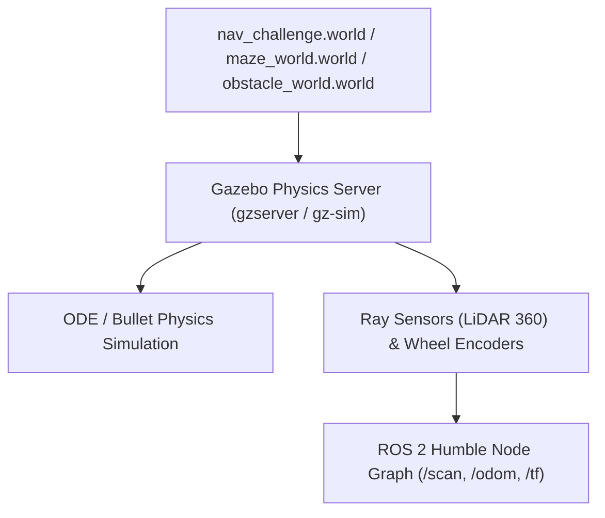

#### Terminal 1 — Gazebo Simulation Bringup (Choose Backend & World)
* **Option 1A — Gazebo Classic + Navigation Challenge World**:
  ```bash
  source /opt/ros/humble/setup.bash
  source ~/ros2_autonomous_navigation_ws/install/setup.bash
  ros2 launch mobile_robot_bringup simulate_robot.launch.py world:=nav_challenge safety_zone:=py
  ```
* **Option 1B — Ignition Gazebo + ROS 2 Control + Maze World**:
  ```bash
  source /opt/ros/humble/setup.bash
  source ~/ros2_autonomous_navigation_ws/install/setup.bash
  ros2 launch mobile_robot_bringup simulate_robot.launch.py sim:=ign controller:=ros2_control world:=maze_world safety_zone:=py
  ```
* **Option 1C — Modern Gz Sim + ROS 2 Control + Obstacle World**:
  ```bash
  source /opt/ros/humble/setup.bash
  source ~/ros2_autonomous_navigation_ws/install/setup.bash
  ros2 launch mobile_robot_bringup simulate_robot.launch.py sim:=gz controller:=ros2_control world:=obstacle_world safety_zone:=py
  ```

#### Terminal 2 — Manual Keyboard Teleoperation
```bash
source /opt/ros/humble/setup.bash
source ~/ros2_autonomous_navigation_ws/install/setup.bash
ros2 run teleop_twist_keyboard teleop_twist_keyboard --ros-args --remap cmd_vel:=/cmd_vel_raw
```

#### Terminal 3 — Sensor Frequency & Topic Health Diagnostics
```bash
source /opt/ros/humble/setup.bash
source ~/ros2_autonomous_navigation_ws/install/setup.bash
ros2 topic list
ros2 topic hz /scan
ros2 topic hz /odom
```

---

### <a id="milestone-2" name="milestone-2"></a>📡 Milestone 2: QoS Profiles & Sensor Diagnostics
* **Package**: `mobile_robot_controller`
* **Features**: Sensor QoS tuning (SensorData Best-Effort vs Reliable), frequency health monitors, and IMU data pipeline.

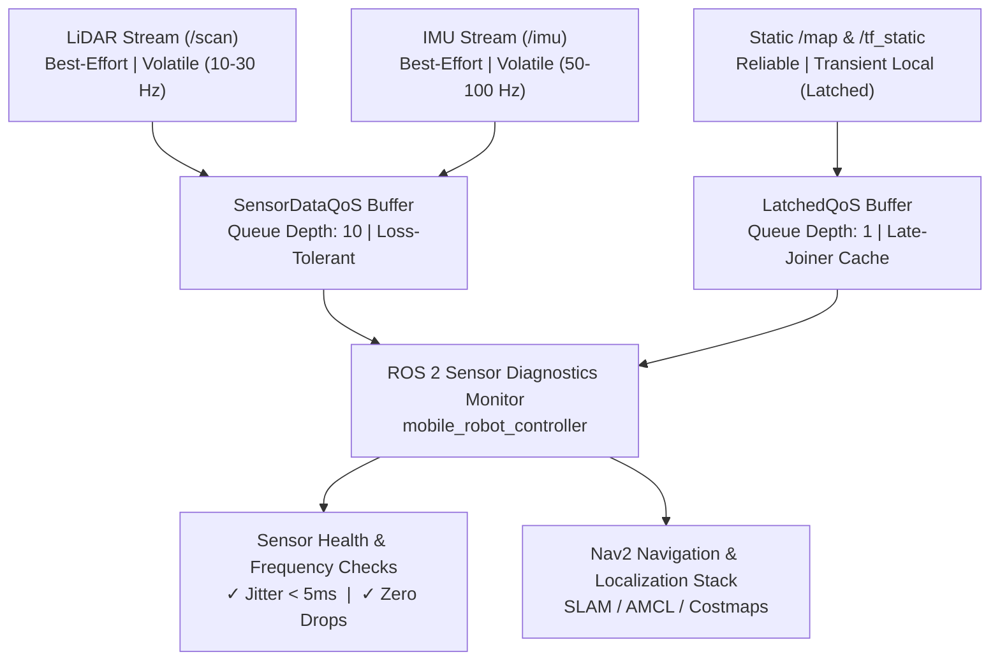

#### Terminal 1 — Simulation Bringup with ROS 2 Control
```bash
source /opt/ros/humble/setup.bash
source ~/ros2_autonomous_navigation_ws/install/setup.bash
ros2 launch mobile_robot_bringup simulate_robot.launch.py sim:=ign controller:=ros2_control world:=nav_challenge safety_zone:=py
```

#### Terminal 2 — Sensor QoS Inspection & Latching Diagnostics
```bash
source /opt/ros/humble/setup.bash
source ~/ros2_autonomous_navigation_ws/install/setup.bash
ros2 topic info --verbose /scan
ros2 topic info --verbose /tf
ros2 topic pub --once --qos-reliability reliable --qos-durability transient_local /test_latch std_msgs/msg/String "data: 'QoS Latch Active'"
ros2 topic echo /test_latch --once --qos-reliability reliable --qos-durability transient_local
```

---

### <a id="milestone-3" name="milestone-3"></a>🗺️ Milestone 3: 2D LiDAR SLAM & Auto-Exploration
* **Package**: `mobile_robot_mapping`
* **Features**: Synchronous and asynchronous 2D LiDAR mapping using SLAM Toolbox, dynamic occupancy grid generation, and serialized map storage.

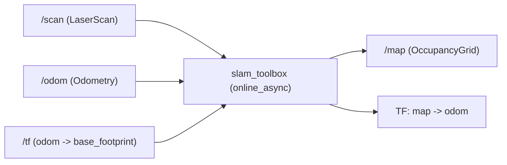

#### Terminal 1 — Modern Gazebo Simulation Bringup
```bash
source /opt/ros/humble/setup.bash
source ~/ros2_autonomous_navigation_ws/install/setup.bash
ros2 launch mobile_robot_bringup simulate_robot.launch.py sim:=gz controller:=ros2_control world:=nav_challenge safety_zone:=py
```

#### Terminal 2 — Launch SLAM Toolbox (Online Asynchronous Mode)
```bash
source /opt/ros/humble/setup.bash
source ~/ros2_autonomous_navigation_ws/install/setup.bash
ros2 launch mobile_robot_mapping slam.launch.py use_sim_time:=true
```

#### Terminal 3 — Manual Keyboard Teleoperation for Mapping
```bash
source /opt/ros/humble/setup.bash
source ~/ros2_autonomous_navigation_ws/install/setup.bash
ros2 run teleop_twist_keyboard teleop_twist_keyboard --ros-args -r cmd_vel:=/cmd_vel_key
```

#### Terminal 4 — Save Generated 2D Costmap (YAML + PGM)
```bash
source /opt/ros/humble/setup.bash
source ~/ros2_autonomous_navigation_ws/install/setup.bash
mkdir -p ~/ros2_autonomous_navigation_ws/src/mobile_robot_mapping/maps
ros2 run nav2_map_server map_saver_cli -f ~/ros2_autonomous_navigation_ws/src/mobile_robot_mapping/maps/nav_challenge_map --ros-args -p use_sim_time:=true
```

#### 📥 Alternative — Direct Download Pre-Built Costmap Pairs
If skipping manual teleoperation mapping, download all 3 pre-built production map pairs directly:
```bash
mkdir -p ~/ros2_autonomous_navigation_ws/src/mobile_robot_mapping/maps

# Download Navigation Challenge Map Pair
curl -fsSL https://raw.githubusercontent.com/rahul-r-joshua/ROS2-Autonomous-Navigation-Masterclass/main/src/mobile_robot_mapping/maps/nav_challenge_map.yaml -o ~/ros2_autonomous_navigation_ws/src/mobile_robot_mapping/maps/nav_challenge_map.yaml
curl -fsSL https://raw.githubusercontent.com/rahul-r-joshua/ROS2-Autonomous-Navigation-Masterclass/main/src/mobile_robot_mapping/maps/nav_challenge_map.pgm -o ~/ros2_autonomous_navigation_ws/src/mobile_robot_mapping/maps/nav_challenge_map.pgm

# Download Maze Map Pair
curl -fsSL https://raw.githubusercontent.com/rahul-r-joshua/ROS2-Autonomous-Navigation-Masterclass/main/src/mobile_robot_mapping/maps/maze_map.yaml -o ~/ros2_autonomous_navigation_ws/src/mobile_robot_mapping/maps/maze_map.yaml
curl -fsSL https://raw.githubusercontent.com/rahul-r-joshua/ROS2-Autonomous-Navigation-Masterclass/main/src/mobile_robot_mapping/maps/maze_map.pgm -o ~/ros2_autonomous_navigation_ws/src/mobile_robot_mapping/maps/maze_map.pgm

# Download Obstacle Map Pair
curl -fsSL https://raw.githubusercontent.com/rahul-r-joshua/ROS2-Autonomous-Navigation-Masterclass/main/src/mobile_robot_mapping/maps/obstacle_map.yaml -o ~/ros2_autonomous_navigation_ws/src/mobile_robot_mapping/maps/obstacle_map.yaml
curl -fsSL https://raw.githubusercontent.com/rahul-r-joshua/ROS2-Autonomous-Navigation-Masterclass/main/src/mobile_robot_mapping/maps/obstacle_map.pgm -o ~/ros2_autonomous_navigation_ws/src/mobile_robot_mapping/maps/obstacle_map.pgm
```

---

### <a id="milestone-4" name="milestone-4"></a>💾 Milestone 4: Map Post-Processing & Costmap Serving
* **Package**: `nav2_map_server` & `mobile_robot_mapping`
* **Features**: Occupancy grid post-processing, static thresholding, map serialization (`.pgm` + `.yaml`), and latched lifecycle map serving.

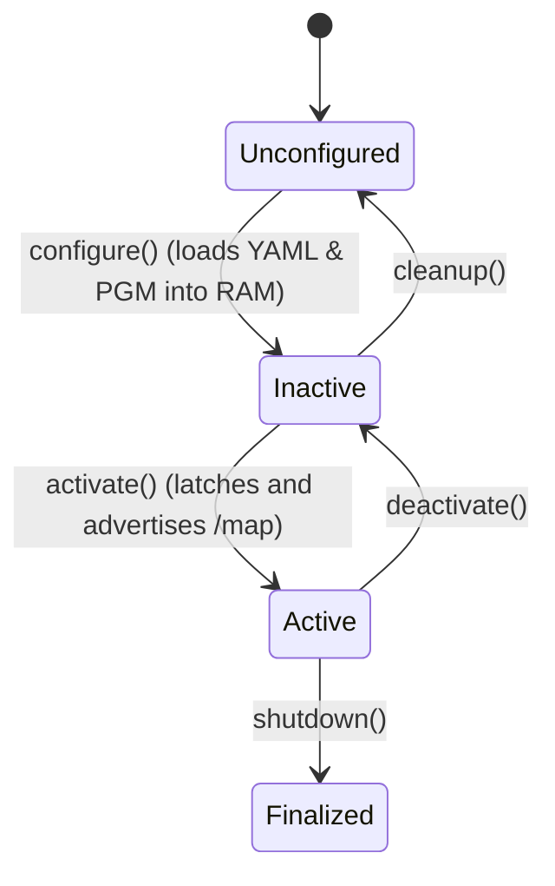

#### Terminal 1 — Gazebo Simulation Bringup
```bash
source /opt/ros/humble/setup.bash
source ~/ros2_autonomous_navigation_ws/install/setup.bash
ros2 launch mobile_robot_bringup simulate_robot.launch.py world:=nav_challenge safety_zone:=py
```

#### Terminal 2 — Launch Nav2 Map Server
```bash
source /opt/ros/humble/setup.bash
source ~/ros2_autonomous_navigation_ws/install/setup.bash
ros2 run nav2_map_server map_server --ros-args -p yaml_filename:=$(ros2 pkg prefix mobile_robot_mapping --share)/maps/nav_challenge_map.yaml -p use_sim_time:=true
```

#### Terminal 3 — Transition Lifecycle Node to Configured State
```bash
source /opt/ros/humble/setup.bash
ros2 lifecycle set /map_server configure
```

#### Terminal 4 — Transition Lifecycle Node to Active State
```bash
source /opt/ros/humble/setup.bash
ros2 lifecycle set /map_server activate
```

#### Terminal 5 — Publish Static Transform (map -> odom)
```bash
source /opt/ros/humble/setup.bash
source ~/ros2_autonomous_navigation_ws/install/setup.bash
ros2 run tf2_ros static_transform_publisher --frame-id map --child-frame-id odom
```

#### Terminal 6 — Verify Latched Map Data Delivery
```bash
source /opt/ros/humble/setup.bash
source ~/ros2_autonomous_navigation_ws/install/setup.bash
ros2 topic echo /map --once --qos-reliability reliable --qos-durability transient_local
```

---

### <a id="milestone-5" name="milestone-5"></a>⚡ Milestone 5: Custom Navigation Interfaces (Actions & Services)
* **Package**: `mobile_robot_msgs`
* **Features**: Custom ROS 2 action `NavigateWaypoint.action` and services `SetSafetyZone.srv` and `GetRobotPose.srv`.

#### ROS 2 Interface Interaction Sequences

##### 1. NavigateWaypoint Action Protocol (`NavigateWaypoint.action`)
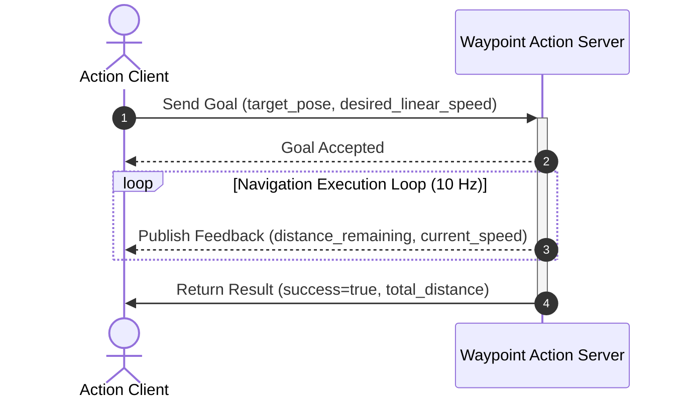

##### 2. Safety Zone Dynamic Configuration Service (`SetSafetyZone.srv`)
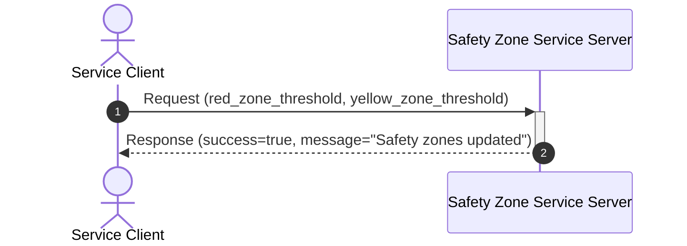

##### 3. TF Robot Pose Query Service (`GetRobotPose.srv`)
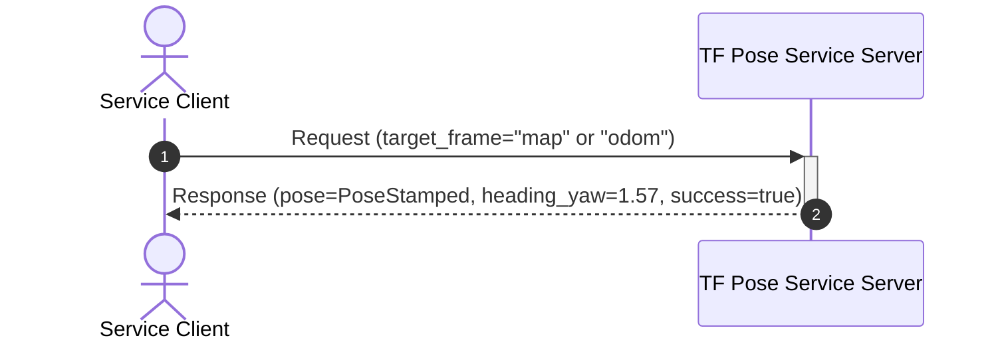

#### ROS 2 Interface Topology Architecture

##### 1. Waypoint Navigation Action Flow (`NavigateWaypoint.action`)
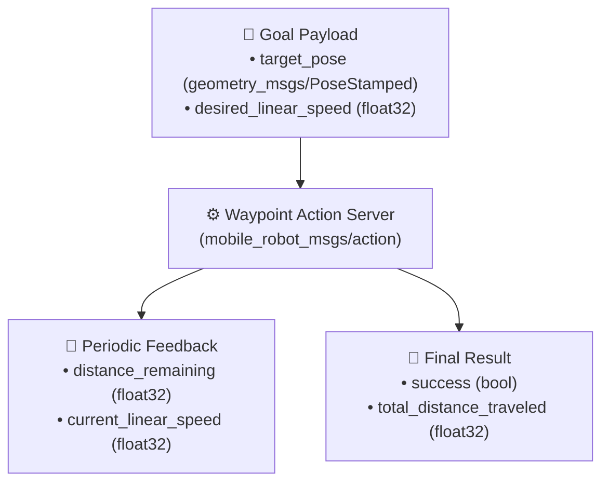

##### 2. Dynamic Safety Zone Service Flow (`SetSafetyZone.srv`)
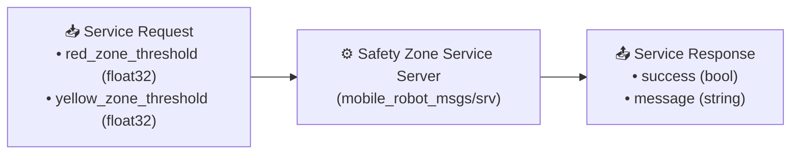

##### 3. TF Robot Pose Query Service Flow (`GetRobotPose.srv`)
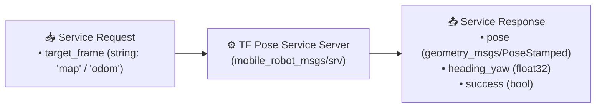

#### Interface Inspection
```bash
source /opt/ros/humble/setup.bash
source ~/ros2_autonomous_navigation_ws/install/setup.bash
ros2 interface show mobile_robot_msgs/action/NavigateWaypoint
```

#### Track A: Safety Zone Dynamic Threshold Service Server & Client Call
* **Terminal 1 — Launch Safety Zone Server**:
  ```bash
  source /opt/ros/humble/setup.bash
  source ~/ros2_autonomous_navigation_ws/install/setup.bash
  python3 ~/ros2_autonomous_navigation_ws/src/mobile_robot_msgs/scripts/set_safety_zone_server.py
  ```
* **Terminal 2 — Call Safety Zone Service**:
  ```bash
  source /opt/ros/humble/setup.bash
  source ~/ros2_autonomous_navigation_ws/install/setup.bash
  ros2 service call /set_safety_zone mobile_robot_msgs/srv/SetSafetyZone "{red_zone_threshold: 0.6, yellow_zone_threshold: 1.2}"
  ```
  *(Expected response: `success=True, message='Safety zones updated: Red=0.60m, Yellow=1.20m'`)*

#### Track B: Waypoint Navigation Action Server with Live Feedback
* **Terminal 1 — Launch Navigation Action Server**:
  ```bash
  source /opt/ros/humble/setup.bash
  source ~/ros2_autonomous_navigation_ws/install/setup.bash
  python3 ~/ros2_autonomous_navigation_ws/src/mobile_robot_msgs/scripts/navigate_waypoint_server.py
  ```
* **Terminal 2 — Send Action Goal with Live Feedback**:
  ```bash
  source /opt/ros/humble/setup.bash
  source ~/ros2_autonomous_navigation_ws/install/setup.bash
  ros2 action send_goal /navigate_waypoint mobile_robot_msgs/action/NavigateWaypoint "{target_pose: {header: {frame_id: 'map'}, pose: {position: {x: 1.5, y: 0.5, z: 0.0}, orientation: {w: 1.0}}}, desired_linear_speed: 1.0}" --feedback
  ```
  *(Expected output: Real-time feedback showing `distance_remaining` decrementing at 0.2s intervals until reaching goal with status `SUCCEEDED`)*

---

### <a id="milestone-6" name="milestone-6"></a>🎯 Milestone 6: AMCL Localization & Multi-Sensor EKF Fusion
* **Package**: `mobile_robot_localization`
* **Features**: Probabilistic AMCL localization on 2D maps and 15-state Extended Kalman Filter (EKF) fusing odometry and IMU.

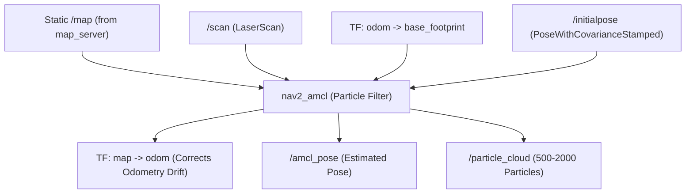

#### Terminal 1 — Gazebo Simulation Bringup with C++ Safety Zone
```bash
source /opt/ros/humble/setup.bash
source ~/ros2_autonomous_navigation_ws/install/setup.bash
ros2 launch mobile_robot_bringup simulate_robot.launch.py world:=obstacle_world controller:=ros2_control safety_zone:=cpp
```

#### Terminal 2 — Map Server & AMCL Global Localization
```bash
source /opt/ros/humble/setup.bash
source ~/ros2_autonomous_navigation_ws/install/setup.bash
ros2 launch mobile_robot_localization global_localization.launch.py map:=$(ros2 pkg prefix mobile_robot_mapping --share)/maps/obstacle_map.yaml use_sim_time:=true
```

#### Terminal 3 — Automatic Initial Pose Dispatcher
```bash
source /opt/ros/humble/setup.bash
source ~/ros2_autonomous_navigation_ws/install/setup.bash
python3 ~/ros2_autonomous_navigation_ws/src/mobile_robot_localization/scripts/auto_initial_pose.py
```

#### Terminal 4 — Manual Keyboard Teleoperation for AMCL Particle Convergence
```bash
source /opt/ros/humble/setup.bash
source ~/ros2_autonomous_navigation_ws/install/setup.bash
ros2 run teleop_twist_keyboard teleop_twist_keyboard --ros-args --remap cmd_vel:=/cmd_vel_raw
```

---

### <a id="milestone-7" name="milestone-7"></a>🧠 Milestone 7: Custom Global Planners (A\* & Dijkstra Plugins)
* **Package**: `mobile_robot_planning`
* **Features**: Custom C++ `nav2_core::GlobalPlanner` plugins (`mobile_robot_planning::AStarPlanner` and `mobile_robot_planning::DijkstraPlanner`) and standalone planner scripts.

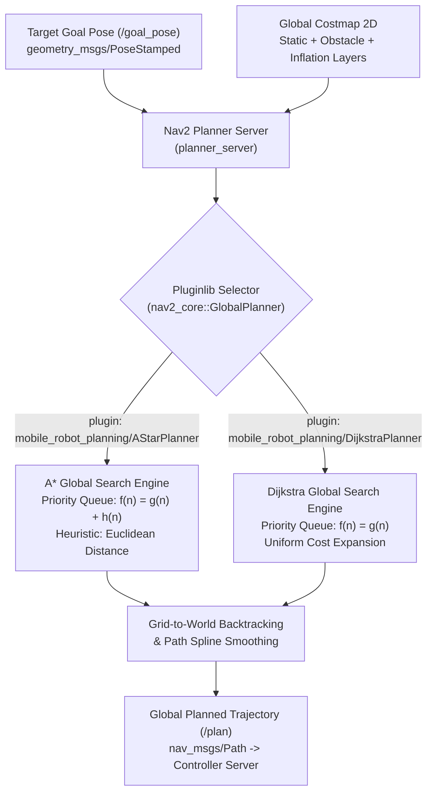

🗺️ **Environment Option B: Maze World**

#### Terminal 1 — Gazebo Simulation & Bringup
```bash
source /opt/ros/humble/setup.bash
source ~/ros2_autonomous_navigation_ws/install/setup.bash
ros2 launch mobile_robot_bringup simulate_robot.launch.py world:=maze_world safety_zone:=py rviz_config:=planning
```

#### Terminal 2 — Map Server & AMCL Global Localization
```bash
source /opt/ros/humble/setup.bash
source ~/ros2_autonomous_navigation_ws/install/setup.bash
ros2 launch mobile_robot_localization global_localization.launch.py map:=$(ros2 pkg prefix mobile_robot_mapping --share)/maps/maze_map.yaml use_sim_time:=true
```

#### Terminal 3 — Run A* Planner Standalone
```bash
source /opt/ros/humble/setup.bash
source ~/ros2_autonomous_navigation_ws/install/setup.bash
ros2 run mobile_robot_planning a_star_planner.py --ros-args --remap /costmap/costmap:=/map
```

#### Terminal 4 — Or Launch Dijkstra Planner Server
```bash
source /opt/ros/humble/setup.bash
source ~/ros2_autonomous_navigation_ws/install/setup.bash
ros2 launch mobile_robot_planning planner.launch.py use_sim_time:=true planner:=dijkstra.py
```

#### Terminal 5 — Dispatch Navigation Goal Pose
* **Goal Pose 1 ($x=1.5, y=0.5$)**:
  ```bash
  source /opt/ros/humble/setup.bash
  source ~/ros2_autonomous_navigation_ws/install/setup.bash
  ros2 topic pub --once /goal_pose geometry_msgs/msg/PoseStamped '{header: {frame_id: "map"}, pose: {position: {x: 1.5, y: 0.5, z: 0.0}, orientation: {w: 1.0}}}'
  ```
* **Goal Pose 2 ($x=2.0, y=1.5$, yaw $\approx 45^\circ$)**:
  ```bash
  source /opt/ros/humble/setup.bash
  source ~/ros2_autonomous_navigation_ws/install/setup.bash
  ros2 topic pub --once /goal_pose geometry_msgs/msg/PoseStamped '{header: {frame_id: "map"}, pose: {position: {x: 2.0, y: 1.5, z: 0.0}, orientation: {z: 0.38268, w: 0.92388}}}'
  ```

---

### <a id="milestone-8" name="milestone-8"></a>🎮 Milestone 8: Custom Local Controllers (Pure Pursuit & PD Motion Plugins)
* **Package**: `mobile_robot_motion`
* **Features**: Custom C++ `nav2_core::Controller` plugins (`mobile_robot_motion::PurePursuit` and `mobile_robot_motion::PDMotion`), standalone trajectory trackers, and universal test bridge.

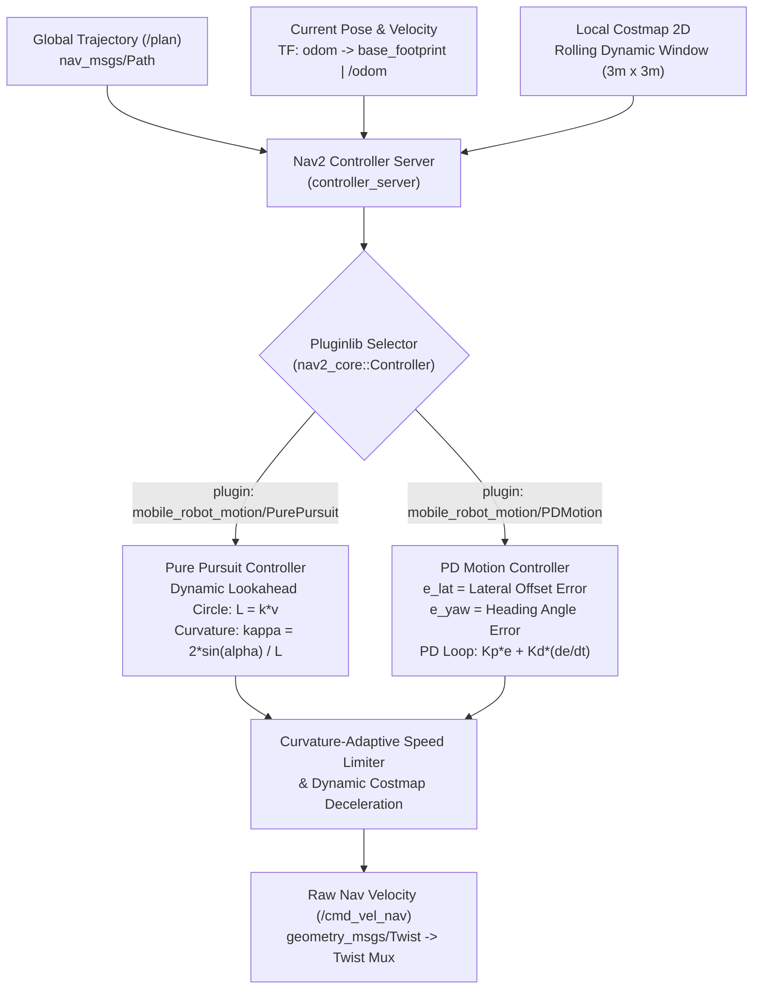

🗺️ **Environment Option C: Obstacle World**

#### Terminal 1 — Gazebo Simulation & Bringup
```bash
source /opt/ros/humble/setup.bash
source ~/ros2_autonomous_navigation_ws/install/setup.bash
ros2 launch mobile_robot_bringup simulate_robot.launch.py world:=obstacle_world safety_zone:=py rviz_config:=planning
```

#### Terminal 2 — Map Server & AMCL Global Localization
```bash
source /opt/ros/humble/setup.bash
source ~/ros2_autonomous_navigation_ws/install/setup.bash
ros2 launch mobile_robot_localization global_localization.launch.py map:=$(ros2 pkg prefix mobile_robot_mapping --share)/maps/obstacle_map.yaml use_sim_time:=true
```

#### Terminal 3 — Launch C++ Global Planner Server
```bash
source /opt/ros/humble/setup.bash
source ~/ros2_autonomous_navigation_ws/install/setup.bash
ros2 launch mobile_robot_planning planner.launch.py use_sim_time:=true planner:=cpp
```

#### Terminal 4 — Launch C++ Controller Server
```bash
source /opt/ros/humble/setup.bash
source ~/ros2_autonomous_navigation_ws/install/setup.bash
ros2 launch mobile_robot_motion controller.launch.py use_sim_time:=true motion:=cpp
```

#### Terminal 5 — Interactive Universal Testing Bridge (`plan_and_follow.py`)
* **Interactive Mode (Provide goal with 2D Goal Pose in RViz2)**:
  ```bash
  source /opt/ros/humble/setup.bash
  source ~/ros2_autonomous_navigation_ws/install/setup.bash
  python3 ~/ros2_autonomous_navigation_ws/src/mobile_robot_motion/scripts/plan_and_follow.py Dijkstra PDMotion
  ```
* **Coordinate Mode (Dijkstra + PDMotion to $x=1.0, y=0.5$)**:
  ```bash
  source /opt/ros/humble/setup.bash
  source ~/ros2_autonomous_navigation_ws/install/setup.bash
  python3 ~/ros2_autonomous_navigation_ws/src/mobile_robot_motion/scripts/plan_and_follow.py Dijkstra PDMotion 1.0 0.5
  ```
* **Origin Return Mode (GridBased + PDMotion to $x=0.0, y=0.0$)**:
  ```bash
  source /opt/ros/humble/setup.bash
  source ~/ros2_autonomous_navigation_ws/install/setup.bash
  python3 ~/ros2_autonomous_navigation_ws/src/mobile_robot_motion/scripts/plan_and_follow.py GridBased PDMotion 0.0 0.0
  ```

#### Terminal 6 — Direct Action Goal Dispatch to `/follow_path`
```bash
source /opt/ros/humble/setup.bash
source ~/ros2_autonomous_navigation_ws/install/setup.bash
ros2 action send_goal /follow_path nav2_msgs/action/FollowPath "{controller_id: 'PDMotion', path: {header: {frame_id: 'map'}, poses: [{header: {frame_id: 'map'}, pose: {position: {x: 0.2, y: 0.0, z: 0.0}, orientation: {w: 1.0}}}, {header: {frame_id: 'map'}, pose: {position: {x: 0.6, y: 0.0, z: 0.0}, orientation: {w: 1.0}}}, {header: {frame_id: 'map'}, pose: {position: {x: 1.0, y: 0.0, z: 0.0}, orientation: {w: 1.0}}}, {header: {frame_id: 'map'}, pose: {position: {x: 1.5, y: 0.0, z: 0.0}, orientation: {w: 1.0}}}]}}"
```

---

### <a id="milestone-9" name="milestone-9"></a>🧭 Milestone 9: Nav2 Navigation Pipeline & Mission Dispatchers
* **Package**: `mobile_robot_navigation`
* **Features**: Complete Nav2 lifecycle pipeline, Behavior Tree with 1 Hz replanning, and autonomous mission dispatchers (`waypoint_follower.py`, `nav_to_pose.py`, `patrol_loop.py`).

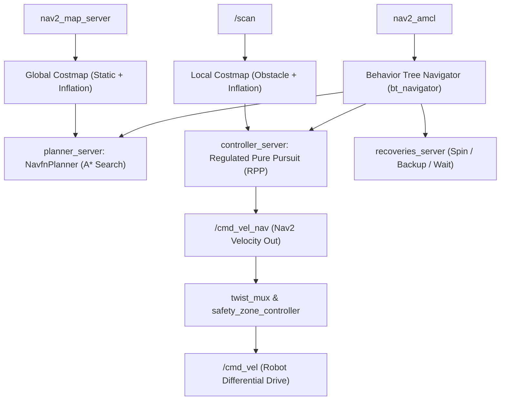

#### Terminal 1 — Simulation Bringup with Navigation RViz Display
```bash
source /opt/ros/humble/setup.bash
source ~/ros2_autonomous_navigation_ws/install/setup.bash
ros2 launch mobile_robot_bringup simulate_robot.launch.py world:=nav_challenge safety_zone:=py rviz_config:=navigation
```

#### Terminal 2 — Map Server & AMCL Global Localization
```bash
source /opt/ros/humble/setup.bash
source ~/ros2_autonomous_navigation_ws/install/setup.bash
ros2 launch mobile_robot_localization global_localization.launch.py map:=$(ros2 pkg prefix mobile_robot_mapping --share)/maps/nav_challenge_map.yaml use_sim_time:=true
```

#### Terminal 3 — Launch Nav2 Core Navigation Stack
```bash
source /opt/ros/humble/setup.bash
source ~/ros2_autonomous_navigation_ws/install/setup.bash
ros2 launch mobile_robot_navigation navigation.launch.py use_sim_time:=true
```

#### Terminal 4 — Autonomous Mission Dispatchers
* **Option 4A — Waypoint Follower**:
  ```bash
  source /opt/ros/humble/setup.bash
  source ~/ros2_autonomous_navigation_ws/install/setup.bash
  ros2 run mobile_robot_navigation waypoint_follower.py nav_challenge
  ```
* **Option 4B — Single Target Pose Navigation**:
  ```bash
  source /opt/ros/humble/setup.bash
  source ~/ros2_autonomous_navigation_ws/install/setup.bash
  ros2 run mobile_robot_navigation nav_to_pose.py nav_challenge
  ```
* **Option 4C — Continuous Perimeter Patrol Loop**:
  ```bash
  source /opt/ros/humble/setup.bash
  source ~/ros2_autonomous_navigation_ws/install/setup.bash
  ros2 run mobile_robot_navigation patrol_loop.py nav_challenge
  ```
* **Optional Safety Zone Bypass (Publish Dynamic Override)**:
  ```bash
  source /opt/ros/humble/setup.bash
  ros2 topic pub /safety_zone_enable std_msgs/msg/Bool "data: false" --once
  ```

---

### <a id="milestone-10" name="milestone-10"></a>🚀 Milestone 10: Master All-in-One Autonomous Bringup
* **Package**: `mobile_robot_bringup`
* **Features**: Master single-command launcher orchestrating Gazebo physics, AMCL localization, Nav2 servers, costmaps, and pre-configured RViz2 display.

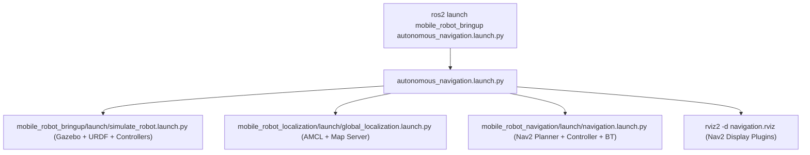

#### Terminal 1 — Master Bringup (Choose Simulator Backend & World)
* **Option 1A — Gazebo Classic + Obstacle World + Python Safety Zone**:
  ```bash
  source /opt/ros/humble/setup.bash
  source ~/ros2_autonomous_navigation_ws/install/setup.bash
  ros2 launch mobile_robot_bringup autonomous_navigation.launch.py sim:=classic world:=obstacle_world safety_zone:=py
  ```
* **Option 1B — Ignition Gazebo + Maze World + C++ Safety Zone**:
  ```bash
  source /opt/ros/humble/setup.bash
  source ~/ros2_autonomous_navigation_ws/install/setup.bash
  ros2 launch mobile_robot_bringup autonomous_navigation.launch.py sim:=ign world:=maze_world safety_zone:=cpp
  ```
* **Option 1C — Modern Gazebo (Gz Sim) + Nav Challenge World + C++ Safety Zone**:
  ```bash
  source /opt/ros/humble/setup.bash
  source ~/ros2_autonomous_navigation_ws/install/setup.bash
  ros2 launch mobile_robot_bringup autonomous_navigation.launch.py sim:=gz world:=nav_challenge safety_zone:=cpp
  ```

#### Terminal 2 — Autonomous Mission Dispatch
```bash
source /opt/ros/humble/setup.bash
source ~/ros2_autonomous_navigation_ws/install/setup.bash
ros2 run mobile_robot_navigation patrol_loop.py maze_world
```

---

### <a id="milestone-11" name="milestone-11"></a>🍓 Milestone 11: Real Robot Hardware Deployment on Raspberry Pi
* **Package**: `mobile_robot_bringup` & `mobile_robot_firmware`
* **Features**: Physical robot bringup on Raspberry Pi 4/5 over serial UART, RPLiDAR A1/A2/A3 scanner integration, and remote DDS workstation visualizer.

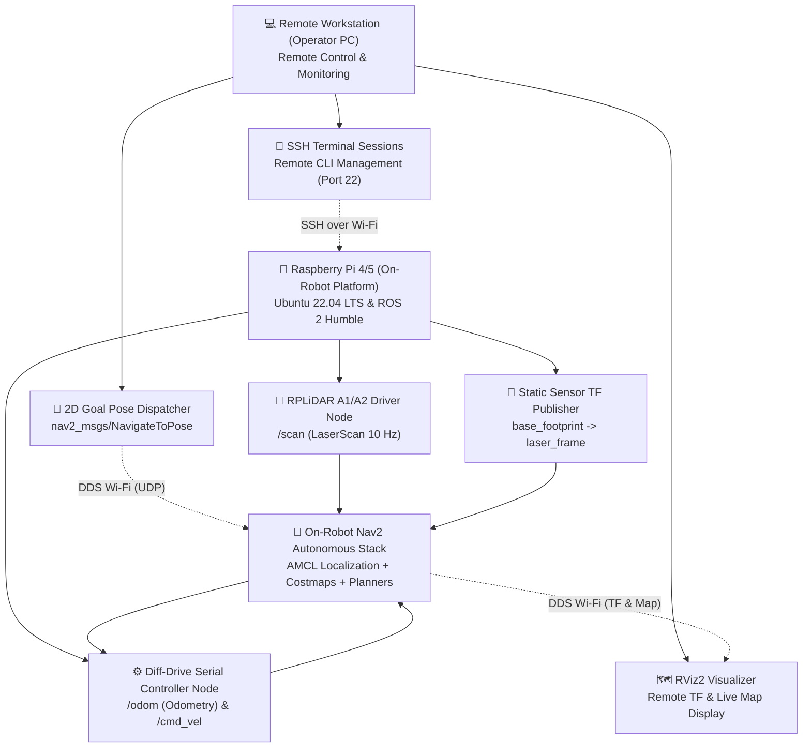

#### Onboard Raspberry Pi 4/5 (via SSH)
* **Terminal 1 — Real Robot Hardware Base (Serial Bridge, Odometry, Transforms)**:
  ```bash
  ssh ubuntu@192.168.1.50
  source /opt/ros/humble/setup.bash
  source ~/ros2_autonomous_navigation_ws/install/setup.bash
  ros2 launch mobile_robot_bringup real_robot.launch.py
  ```
* **Terminal 2 — RPLiDAR A1 Sensor Bringup**:
  ```bash
  ssh ubuntu@192.168.1.50
  source /opt/ros/humble/setup.bash
  source ~/ros2_autonomous_navigation_ws/install/setup.bash
  ros2 launch rplidar_ros rplidar_a1.launch.py serial_port:=/dev/ttyUSB0 frame_id:=laser_frame
  ```
* **Terminal 3 — Manual Keyboard Teleoperation**:
  ```bash
  ssh ubuntu@192.168.1.50
  source /opt/ros/humble/setup.bash
  source ~/ros2_autonomous_navigation_ws/install/setup.bash
  ros2 run teleop_twist_keyboard teleop_twist_keyboard --ros-args -r cmd_vel:=/cmd_vel_joy
  ```
* **Terminal 4 — Autonomous Navigation Stack on Edge Hardware**:
  ```bash
  ssh ubuntu@192.168.1.50
  source /opt/ros/humble/setup.bash
  source ~/ros2_autonomous_navigation_ws/install/setup.bash
  ros2 launch mobile_robot_navigation navigation.launch.py map:=$HOME/ros2_autonomous_navigation_ws/src/mobile_robot_mapping/maps/nav_challenge_map.yaml use_sim_time:=false
  ```

#### Remote Developer Workstation
* **Terminal 5 — RViz2 Remote Visualizer**:
  ```bash
  source /opt/ros/humble/setup.bash
  source ~/ros2_autonomous_navigation_ws/install/setup.bash
  ros2 launch mobile_robot_navigation rviz.launch.py
  ```

---

## <a id="curriculum-matrix" name="curriculum-matrix"></a>📊 Complete 11-Milestone Curriculum Matrix

| Milestone | Package Name | Primary Role & Topic | Language | Key Output Artifact |
| :---: | :--- | :--- | :---: | :--- |
| **🌐 M1** | `mobile_robot_gazebo` | Gazebo Multi-World Physics Simulation | XML / SDF | 3 Gazebo Worlds (`nav_challenge`, `maze`, `obstacle`) |
| **📡 M2** | `mobile_robot_controller` | Sensor QoS Profiles & Teleoperation | Python / C++ | QoS Diagnostic Monitor & Twist Relay |
| **🗺️ M3** | `mobile_robot_mapping` | 2D LiDAR Simultaneous Localization & Mapping | YAML / C++ | SLAM Toolbox Configuration & Map Generation |
| **💾 M4** | `nav2_map_server` | Map Post-Processing & Costmap Serving | YAML / PGM | 3 Serialized Map Pairs (`.yaml` + `.pgm`) |
| **⚡ M5** | `mobile_robot_msgs` | Custom Navigation Interfaces | ROS 2 IDL | `NavigateWaypoint.action`, `SetSafetyZone.srv` |
| **🎯 M6** | `mobile_robot_localization`| Probabilistic AMCL & Multi-Sensor EKF | C++ / Python | AMCL Particle Filter & Robot Localization EKF |
| **🧠 M7** | `mobile_robot_planning` | Custom Nav2 Global Path Planners | Modern C++ | C++ A\* & Dijkstra `nav2_core::GlobalPlanner` Plugins |
| **🎮 M8** | `mobile_robot_motion` | Custom Nav2 Local Tracking Controllers | Modern C++ | C++ Pure Pursuit & PD `nav2_core::Controller` Plugins |
| **🧭 M9** | `mobile_robot_navigation`| Nav2 Navigation Stack & Behavior Trees | XML / Python | Nav2 Pipeline, Behavior Trees, Mission Dispatchers |
| **🚀 M10** | `mobile_robot_bringup` | Master All-in-One Autonomous Bringup | Python Launch | `autonomous_navigation.launch.py` Master Launcher |
| **🍓 M11** | `mobile_robot_bringup` | Real Hardware Raspberry Pi Deployment | Python / C++ | `real_robot.launch.py` Hardware Edge Bringup |

---

## <a id="simulator-matrix" name="simulator-matrix"></a>🌐 Multi-Simulator & Multi-World Matrix (18 Configurations)

The workspace provides seamless switching across 3 simulators, 3 worlds, and 2 safety modes without editing code:

| Simulator Backend | World Environment | Safety Mode | Master Launch Command |
| :--- | :--- | :---: | :--- |
| **Gazebo Classic 11** | `nav_challenge` | Python / C++ | `ros2 launch mobile_robot_bringup autonomous_navigation.launch.py sim:=classic world:=nav_challenge` |
| **Gazebo Classic 11** | `maze_world` | Python / C++ | `ros2 launch mobile_robot_bringup autonomous_navigation.launch.py sim:=classic world:=maze_world` |
| **Gazebo Classic 11** | `obstacle_world` | Python / C++ | `ros2 launch mobile_robot_bringup autonomous_navigation.launch.py sim:=classic world:=obstacle_world` |
| **Ignition Gazebo** | `nav_challenge` | Python / C++ | `ros2 launch mobile_robot_bringup autonomous_navigation.launch.py sim:=ign world:=nav_challenge` |
| **Ignition Gazebo** | `maze_world` | Python / C++ | `ros2 launch mobile_robot_bringup autonomous_navigation.launch.py sim:=ign world:=maze_world` |
| **Ignition Gazebo** | `obstacle_world` | Python / C++ | `ros2 launch mobile_robot_bringup autonomous_navigation.launch.py sim:=ign world:=obstacle_world` |
| **Modern Gazebo (Gz)**| `nav_challenge` | Python / C++ | `ros2 launch mobile_robot_bringup autonomous_navigation.launch.py sim:=gz world:=nav_challenge` |
| **Modern Gazebo (Gz)**| `maze_world` | Python / C++ | `ros2 launch mobile_robot_bringup autonomous_navigation.launch.py sim:=gz world:=maze_world` |
| **Modern Gazebo (Gz)**| `obstacle_world` | Python / C++ | `ros2 launch mobile_robot_bringup autonomous_navigation.launch.py sim:=gz world:=obstacle_world` |
| **Pure Nav2 Mode** | Any World | None | `ros2 launch mobile_robot_bringup autonomous_navigation.launch.py safety_zone:=none` |

---

## <a id="automated-test-suite" name="automated-test-suite"></a>🧪 Automated Master Test Suite (62/62 Checks Passed)

Verify all 11 packages, interface definitions, worlds, maps, launch files, parameter files, plugin manifests, and autonomous mission scripts with a single command:

```bash
python3 Scripts/verify_all_milestones.py
```

### Verification Coverage:
* **Stage 1**: 11 ROS 2 Package Trees verified.
* **Stage 2**: 3 Custom Interfaces (`NavigateWaypoint`, `SetSafetyZone`, `GetRobotPose`) verified.
* **Stage 3**: 3 Gazebo Simulation Worlds verified.
* **Stage 4**: 3 2D Costmap pairs (`.yaml` + `.pgm`) verified.
* **Stage 5**: 22 Launch & Parameter YAML files verified.
* **Stage 6**: Custom Nav2 Plugin manifests (`global_planner_plugins.xml`, `motion_controller_plugins.xml`) verified.
* **Stage 7**: 18 Autonomous Nodes, C++ binaries, and Python mission scripts verified.

---

## <a id="architectural-deep-dives" name="architectural-deep-dives"></a>📚 Architectural Deep Dives & Theory References

👉 **For the complete, line-by-line engineering manual covering all 11 milestones in exhaustive detail, visit:**
[📖 Master In-Depth Implementation Guide (`src/README.md`)](src/README.md)

### Key Architectural References Inside `src/README.md`:
* **🧠 In-Depth Engine Guide**: A\* Search Algorithm heuristic mechanisms ($f(n) = g(n) + h(n)$) and Regulated Pure Pursuit curvature velocity scaling.
* **🛡️ Costmap Stabilization Deep Dive**: Eliminating local costmap spinning and orientation drift via skid-steer track width calibration ($0.457\text{m}$), single TF source of truth, and `global_frame: odom` decoupling.
* **🎯 Critical Stability Rule**: Ensuring $\text{xy\_goal\_tolerance} < \text{min\_lookahead\_dist}$ to prevent path-start deadlocks in Nav2 controllers.

---

## <a id="faq" name="faq"></a>💡 Frequently Asked Questions (FAQ)

| # | Question / Issue | Root Cause | Instant Resolution |
| :-: | :--- | :--- | :--- |
| **1** | **RViz2 shows `Fixed Frame [map] does not exist` on launch?** | Normal during decoupled startup. AMCL and Map Server publish `map` in Terminal 2. | Launch Terminal 2 (Localization); the warning vanishes automatically once AMCL activates. |
| **2** | **Robot pauses or aborts mission with `Failed to make progress`?** | Safety zone controller triggered emergency brake in narrow corridor. | Launch with `safety_zone:=none` or disable via: `ros2 topic pub /safety_zone_enable std_msgs/msg/Bool "data: false" --once`. |
| **3** | **How to test custom A\* planner and Pure Pursuit controller interactively?** | Direct Action testing bridge. | Run `ros2 run mobile_robot_motion plan_and_follow.py GridBased FollowPath` and click **2D Goal Pose** in RViz2. |
| **4** | **Serial permission denied on physical hardware (`/dev/ttyUSB0`)?** | User not in Linux `dialout` group. | `sudo usermod -a -G dialout $USER && newgrp dialout`. |
| **5** | **Zombie simulator processes blocking new launch?** | Background `gzserver` or FastDDS shared memory conflict. | `killall -9 gzserver gzclient rviz2 ruby 2>/dev/null || true && ros2 daemon stop`. |

---

## <a id="author-and-support" name="author-and-support"></a>👤 Author & Maintainer

**Rahul Ramasamy**

* 🐙 **GitHub**: [https://github.com/rahul-r-joshua](https://github.com/rahul-r-joshua)
* 🌐 **Portfolio**: [https://rahul-r-joshua.github.io/portfolio/](https://rahul-r-joshua.github.io/portfolio/)
* 💼 **LinkedIn**: [https://www.linkedin.com/in/rahul-ramasamy-in/](https://www.linkedin.com/in/rahul-ramasamy-in/)
* 📧 **Email**: rahul.r.joshua123@gmail.com

---

### 💬 Support & Contact
For any bugs, feature requests, or questions regarding ROS 2 Autonomous Navigation, feel free to open an issue or connect on LinkedIn.

<div align="center">
  <sub>Engineered for the ROS 2 Autonomous Robotics Community.</sub>
</div>
